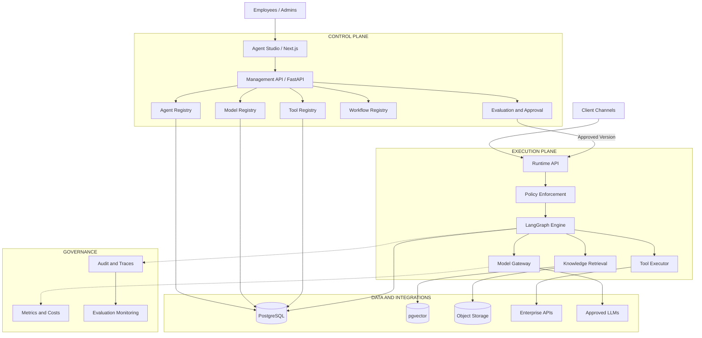
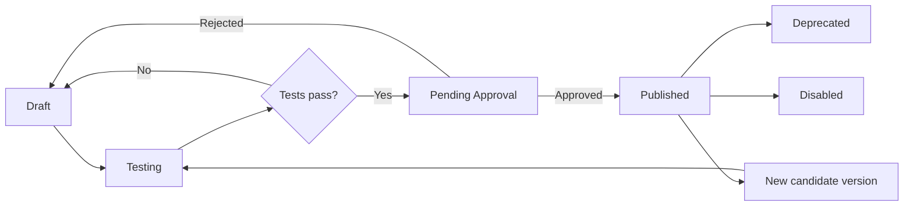
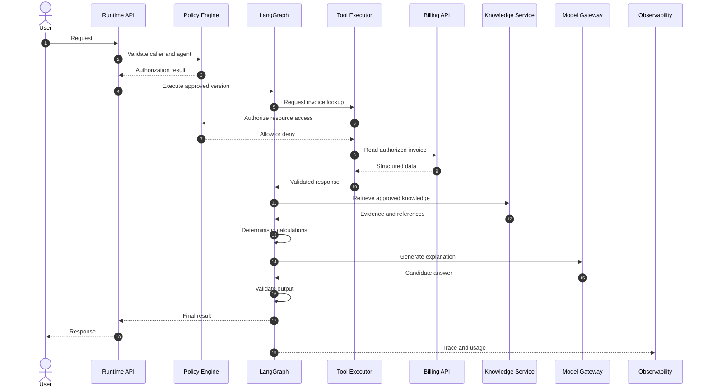
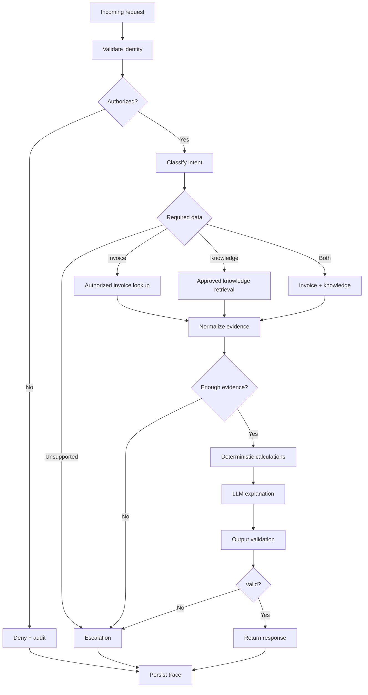
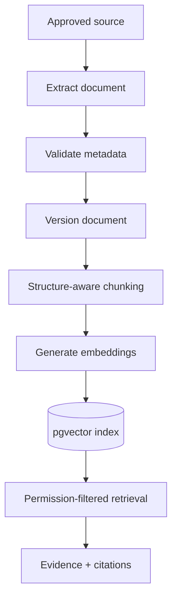
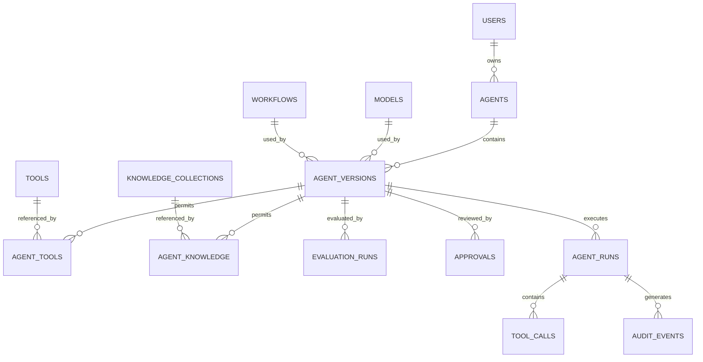

# BIA Agent Studio - System Architecture

**Version:** 1.0
**Status:** Proposed architecture
**Project:** BIA Agent Studio
**Context:** BIA AI Engineer Challenge - Option B

**Implementation checkpoint (2026-10-16):** Sprints 1–5 implement Foundation,
Agent Management, local LangGraph Runtime, Quality & Governance, and a small
Knowledge & RAG pipeline. Knowledge collections, immutable document versions,
bounded PDF/TXT/Markdown ingestion, pinned local multilingual semantic embeddings,
pgvector + Spanish lexical retrieval, authorization/validity filters, citations,
and retrieval traces are integrated with billing snapshots and publication gates.
Originals use a bounded PostgreSQL-backed object-store abstraction; there is no
S3 service. Chunking is a character-window baseline with overlap, not a complete
structure-aware parser. Production SSO, recovery workers, OCR, enterprise quotas
and external knowledge connectors remain outside this slice.
The target architecture below is broader than the repository. See
[ADR-011](decisions/ADR-011-agent-runtime.md),
[ADR-012](decisions/ADR-012-quality-governance.md),
[ADR-013](decisions/ADR-013-knowledge-rag.md), and the
[Sprint 5 guide](sprint-5-guide.md) for implemented boundaries and verification.

**Product integration update (2026-10-16):** `/dashboard` consolidates visible
agent/collection inventory, caller-scoped execution metrics and recent trace
links using the existing authenticated APIs. It shares its metrics presentation
with Trace Viewer; there is no new analytics service or frontend permission
engine. The public `/` infrastructure health page remains available. Browser
tests create an isolated Knowledge collection through the UI, preserving previous
documents and avoiding assumptions about top-k ranking in a shared corpus.
This local integration does not add production identity or a public deployment.

**Deployment preparation (2026-10-16):** an optional private access-token mode
now authenticates operator-issued 256-bit credentials through SHA-256 hashes,
expiry and revocation in PostgreSQL. Legacy demo tokens remain development-only
and cannot authenticate in this mode. An explicitly enabled deployment runtime
admits only the published channel and trusted internal evaluations; preview
remains local. The same publication gate, resource authorization, StateGraph and
retrieval pipeline apply. Railway deployment instructions and IaC are prepared;
no Railway deployment or public URL has been verified. This is a protected
synthetic demonstration, without corporate SSO/MFA or enterprise hardening. See
[ADR-014](decisions/ADR-014-protected-deployment.md) and the
[deployment guide](railway-deployment.md).

---

# 1. Overview

## 1.1 Problem

Different business teams may build AI agents independently,
using different models, integrations, knowledge sources,
and monitoring mechanisms.

This creates fragmentation:

- No unified inventory of agents.
- Unclear ownership.
- Inconsistent model and tool access.
- Limited execution traceability.
- Duplicated engineering effort.
- No common evaluation process.
- Fragmented operational costs.

## 1.2 Proposed Solution

BIA Agent Studio is a governed internal platform for
creating, managing, evaluating, executing, and monitoring
AI agents.

Employees should be able to create agents without coding.

The platform must enforce:

- Approved model usage
- Approved tool usage
- Resource-level authorization
- Versioned configurations
- Evaluation before publication
- Execution traceability
- Usage and cost visibility

The long-term goal is an enterprise agent platform.

The immediate goal is a functional reference implementation
with one business workflow.

## 1.3 Core Architectural Principle

The LLM is not the security authority.

The LLM may request a tool or generate a response.

Backend policies determine:

- Whether the caller is authorized.
- Whether the agent can use the tool.
- Whether the caller can access the resource.
- Whether the operation can execute.
- Whether an action requires approval.

These checks must not rely on prompt instructions.

---

# 2. System Architecture

## 2.1 Architectural Style

Use two logical planes:

1. Control Plane
2. Execution Plane

Cross-cutting capabilities:

- Security
- Observability
- Evaluation
- Audit
- Cost management

Initially, implement a modular backend rather than
one microservice for every domain.

Keep execution workers separable from management APIs.

## 2.2 High-Level Architecture



The architecture diagram describes logical responsibilities,
not necessarily independently deployed services.

## 2.3 Technology Decisions

| Component | Choice | Rationale |
|---|---|---|
| Frontend | Next.js | Modern internal web portal |
| Backend | FastAPI | Typed Python APIs |
| Validation | Pydantic | Reliable schemas |
| Orchestration | LangGraph | Explicit stateful workflows |
| Model Gateway | LiteLLM | Provider abstraction |
| Database | PostgreSQL | Transactional persistence |
| Vector Search | pgvector | Integrated retrieval |
| ORM | SQLAlchemy | Database access |
| Migrations | Alembic | Schema evolution |
| LLM Tracing | Langfuse | Optional advanced observability |
| Telemetry | OpenTelemetry | Cross-service correlation |
| Local Infra | Docker Compose | Reproducible development |

All technologies must be justified by implemented needs.

---

# 3. Control Plane

## 3.1 Responsibilities

The Control Plane owns:

- Agent definitions
- Model definitions
- Tool registrations
- Workflow definitions
- Knowledge collection metadata
- Agent versioning
- Evaluation configurations
- Publication policies
- Administrative access

It must not allow agent-generated outputs to change
administrative permissions.

## 3.2 Agent Registry

The Agent Registry stores the logical identity of agents.

Example:

```json
{
  "id": "billing-assistant",
  "name": "Billing Assistant",
  "department": "customer_service",
  "owner": "billing-team",
  "status": "active",
  "published_version": "1.0.0"
}
```

A logical agent may contain multiple versions.

## 3.3 Model Registry

Store:

- Provider and exact model identifier
- Capabilities
- Context limits
- Cost configuration
- Tool support
- Data-handling restrictions
- Approved status
- Version or release identifier

Expose user-friendly profiles:

- economy
- balanced
- advanced
- restricted

Published versions must resolve profiles to exact
effective configurations.

## 3.4 Tool Registry

Each tool is a registered capability.

Metadata includes:

```json
{
  "name": "get_customer_invoice",
  "version": "1.0.0",
  "operation": "read",
  "timeout_seconds": 5,
  "requires_resource_authorization": true,
  "status": "approved"
}
```

Tool contracts define input, output, errors, and permissions.

Unapproved tools must not execute.

## 3.5 Workflow Registry

Each workflow definition includes:

- Workflow ID
- Version
- Input contract
- Output contract
- State schema
- Allowed tool types
- Maximum steps
- Error transitions
- Approval requirements

The registry links an agent version to an approved workflow.

## 3.6 Knowledge Registry

Stores:

- Knowledge collection
- Owner
- Access scope
- Document versions
- Approval state
- Effective dates
- Retrieval configuration

The runtime must not use collections that were not authorized
for the executing agent and caller.

## 3.7 Publication

Publication requires:

1. Valid agent configuration.
2. Approved model and tools.
3. Authorization to publish.
4. Required evaluation results.
5. No critical security failures.
6. Approval record.
7. Immutable effective configuration.

The active version pointer must be updated transactionally.

Published agent versions are not edited in place.

---

# 4. Agent Model

## 4.1 Definition

An agent is a versioned, executable business capability
defined by:

- Identity
- Objective
- Instructions
- Model
- Workflow
- Tools
- Knowledge
- Permissions
- Execution limits
- Evaluation requirements

An agent is not merely an LLM prompt.

## 4.2 Manifest

Example:

```yaml
apiVersion: bia.ai/v1
kind: Agent

metadata:
  id: billing-assistant
  name: Billing Assistant
  owner: billing-team
  version: 1.0.0

spec:
  objective: Explain authorized customer invoices

  model:
    profile: balanced
    max_output_tokens: 1000

  workflow:
    id: billing_workflow_v1
    max_steps: 6
    timeout_seconds: 30

  tools:
    - get_customer_invoice
    - get_previous_invoice
    - search_billing_knowledge

  knowledge:
    collections:
      - approved_tariffs
      - billing_faq

  security:
    require_authentication: true
    resource_scope: own_invoices
    allow_financial_writes: false

  evaluation:
    suite: billing_evaluation_v1
```

This manifest describes the requested configuration.

The backend must validate and resolve it before publication.

## 4.3 Lifecycle



Publication produces an immutable snapshot.

Execution references the snapshot, not a mutable draft.

---

# 5. Guided Agent Builder

## 5.1 Goal

Employees should create agents through structured forms
and approved templates rather than writing arbitrary
system prompts.

## 5.2 Creation Flow

1. Describe a business problem.
2. Select an agent template.
3. Choose approved capabilities.
4. Select allowed knowledge sources.
5. Select a model profile.
6. Generate suggested instructions.
7. Validate the configuration.
8. Test the agent.
9. Request publication.

## 5.3 Suggested Templates

- FAQ Assistant
- Knowledge Assistant
- Data Lookup Assistant
- Classification Assistant
- Controlled Workflow Assistant

## 5.4 AI-Assisted Configuration

An LLM may generate proposed instructions.

Output must follow a validated schema.

The LLM cannot:

- Grant permissions
- Register arbitrary tools
- Add unauthorized knowledge collections
- Override security policy
- Publish the agent

These operations require backend validation and,
where appropriate, human approval.

---

# 6. Execution Plane

## 6.1 Request Lifecycle

A runtime request follows:

1. Authenticate caller.
2. Authorize agent invocation.
3. Resolve approved agent version.
4. Load workflow configuration.
5. Initialize trusted execution context.
6. Execute LangGraph.
7. Authorize tool calls.
8. Retrieve approved evidence.
9. Generate and validate output.
10. Persist execution record.
11. Return result or controlled error.

## 6.2 Runtime Sequence



Authorization failures terminate the affected path.

The diagram depicts the successful branch;
all external calls require explicit failure handling.

## 6.3 State Management

Use a typed LangGraph state.

Example:

```python
from typing import Any, Literal, TypedDict

class BillingState(TypedDict):
    run_id: str
    agent_version_id: str
    message: str
    intent: Literal[
        "invoice",
        "knowledge",
        "mixed",
        "escalation",
    ]
    invoice_data: dict[str, Any] | None
    knowledge_results: list[dict[str, Any]]
    calculation_results: dict[str, Any]
    response: str | None
    errors: list[str]
```

Sensitive authentication context must not be trusted
from the LLM or arbitrary client-provided state.

Use server-side execution context for trusted identity
and authorization attributes.

Persist checkpoints only where recovery is required.

## 6.4 Deterministic vs LLM Operations

Use deterministic code for:

- Authentication
- Authorization
- Monetary calculations
- Validation
- Date filtering
- Resource ownership
- Workflow termination rules

Use LLMs for:

- Understanding requests
- Bounded intent classification
- Explanation generation
- Language transformation
- Structured extraction when appropriate

The LLM must not be the source of truth for financial data.

---

# 7. Billing Reference Agent

## 7.1 Purpose

Explain differences between authorized customer invoices.

Use synthetic data only in the MVP.

## 7.2 Capabilities

- Read an authorized invoice
- Read a previous authorized invoice
- Compare consumption
- Compare charges
- Retrieve tariff information
- Explain differences
- Escalate unsupported cases

Financial write operations are not supported.

## 7.3 Execution Workflow



## 7.4 Synthetic Business Example

August:

- Consumption: 350 kWh
- Unit rate: 800 COP/kWh
- Consumption charge: 280,000 COP

September:

- Consumption: 420 kWh
- Unit rate: 820 COP/kWh
- Consumption charge: 344,400 COP

Difference:

344,400 - 280,000 = 64,400 COP

Percentage increase:

64,400 / 280,000 * 100 = 23%

Breakdown:

- Consumption effect: 56,000 COP
- Rate effect: 8,400 COP
- Total difference: 64,400 COP

This simplified example contains only consumption charges.
All values are hypothetical.

The calculations must be performed in Python and tested.

## 7.5 Billing Tool Contract

Tool name:

`get_customer_invoice`

Model-supplied input:

```json
{
  "invoice_id": "INV-1002"
}
```

Trusted caller identity:

Resolved by the backend, not supplied as an LLM argument.

Response:

```json
{
  "invoice_id": "INV-1002",
  "period": "2026-09",
  "currency": "COP",
  "consumption_kwh": 420,
  "unit_rate_cop": 820,
  "consumption_charge_cop": 344400,
  "status": "issued"
}
```

Errors:

- UNAUTHENTICATED
- FORBIDDEN
- INVOICE_NOT_FOUND
- UPSTREAM_TIMEOUT
- UPSTREAM_UNAVAILABLE
- INVALID_RESPONSE

The tool must reject requests outside the caller's
authorized resource scope.

## 7.6 Important Test Cases

- Valid authorized invoice
- Unauthorized invoice
- Missing invoice
- Invalid invoice ID
- API timeout
- Previous invoice unavailable
- Tariff document out of date
- Prompt injection in retrieved text
- Exceeded tool limit
- Incorrect or missing model response

---

# 8. Knowledge and RAG

## 8.1 Purpose

Use retrieval for changing documentary knowledge:

- Tariffs
- FAQ
- Procedures
- Policies

Use APIs for transactional data.

## 8.2 Ingestion Pipeline



## 8.3 Document Metadata

Store:

- document_id
- version
- source
- owner
- access_scope
- classification
- effective_from
- effective_to
- ingestion_status
- embedding_model_version
- checksum

## 8.4 Retrieval Policy

The Knowledge Service must:

1. Resolve caller scope.
2. Restrict allowed collections.
3. Filter documents by access and validity.
4. Retrieve relevant chunks.
5. Recheck authorization before returning content.
6. Return references and version identifiers.

Retrieved text is untrusted data.

It cannot override agent policies.

## 8.5 Retrieval Strategy

Begin with a measurable baseline.

Use hybrid retrieval when appropriate:

- Lexical search for exact terms and IDs.
- Vector search for semantic similarity.
- Optional reranking for evidence quality.

Evaluate retrieval independently from answer generation.

## 8.6 RAG vs Fine-Tuning

RAG is appropriate for changing knowledge with references.

Fine-tuning may be considered for repetitive learned
behavior such as classification when evaluation data
justifies the additional complexity.

Do not use fine-tuning to memorize mutable tariffs
or customer account balances.

---

# 9. Security Architecture

## 9.1 Trust Boundaries

Trust levels:

1. Authenticated platform services
2. Authorized backend execution context
3. Registered tool implementations
4. External API responses
5. Retrieved documents
6. User messages
7. LLM outputs

User messages, retrieved documents, tool responses,
and LLM outputs must be validated before influencing
privileged operations.

## 9.2 Authorization Layers

### Agent Authorization

May this caller execute the agent?

### Tool Authorization

May this agent use the requested tool?

### Resource Authorization

May this caller access the requested invoice or document?

### Publication Authorization

May this person approve and publish this version?

All layers must be enforced by backend services.

## 9.3 Roles

Initial roles:

- Viewer
- Creator
- Reviewer
- Approver
- Administrator
- Auditor

Add attribute-based policies for resource-level decisions.

A role alone must not grant access to every invoice.

## 9.4 Prompt Injection

Possible attacks:

- Malicious instructions inside documents
- Attempts to reveal prompts or credentials
- Attempts to invoke unapproved tools
- Attempts to switch resource identity
- Attempts to exfiltrate data

Primary controls:

- Tool allowlists
- Backend authorization
- Typed arguments
- Network restrictions
- Secret isolation
- Strict resource access checks
- Adversarial evaluation

Prompt filtering is defense in depth, not the
primary authorization mechanism.

## 9.5 Logging and Privacy

Persist operational metadata needed for tracing.

Avoid unnecessary storage of:

- Personal identifiers
- Full sensitive prompts
- Provider secrets
- Unredacted private documents

Where complete content retention is necessary,
use restricted storage and explicit retention rules.

## 9.6 Production Authentication

Synthetic demo authentication is acceptable only
for local or clearly isolated demo environments.

Real production use requires corporate identity
integration and validated authorization policies.

---

# 10. Data Architecture

## 10.1 Persistence Strategy

Use PostgreSQL for transactional platform records.

Use pgvector for vector indexes when needed.

Use object storage for original documents and
large execution artifacts.

Keep authoritative enterprise data in source systems.

## 10.2 Main Entities



## 10.3 Core Tables

- users
- agents
- agent_versions
- models
- workflows
- tools
- agent_tools
- knowledge_collections
- agent_knowledge
- documents
- document_chunks
- evaluation_suites
- evaluation_runs
- approvals
- agent_runs
- tool_calls
- audit_events

Create tables progressively through Alembic migrations.

## 10.4 Consistency

Important invariants:

- Published versions are immutable.
- Every run references a version.
- A version cannot publish without required approvals.
- Unapproved tools cannot execute.
- Resource authorization is always enforced.
- Publication state changes are transactional.
- Audit records cannot be edited by ordinary users.

Database constraints should enforce integrity
where possible.

---

# 11. API Architecture

## 11.1 API Style

Use versioned REST endpoints.

Use JSON and typed Pydantic contracts.

Do not expose unrestricted internal model objects.

## 11.2 Agent Management

Suggested endpoints:

GET /api/v1/agents

POST /api/v1/agents

GET /api/v1/agents/{agent_id}

POST /api/v1/agents/{agent_id}/versions

GET /api/v1/agents/{agent_id}/versions

## 11.3 Catalogs

GET /api/v1/models

GET /api/v1/tools

GET /api/v1/workflows

GET /api/v1/knowledge/collections

## 11.4 Evaluations and Publication

POST /api/v1/agents/{agent_id}/versions/{version}/evaluations

POST /api/v1/agents/{agent_id}/versions/{version}/submit

POST /api/v1/agents/{agent_id}/versions/{version}/approve

POST /api/v1/agents/{agent_id}/versions/{version}/publish

Authorization and lifecycle transition validation
are mandatory.

## 11.5 Runtime

POST /api/v1/runs

GET /api/v1/runs/{run_id}

GET /api/v1/runs/{run_id}/trace

Example request:

```json
{
  "agent_id": "billing-assistant",
  "message": "Explain my September invoice",
  "session_id": "session_123"
}
```

Do not accept user identity from untrusted body fields.

Example response:

```json
{
  "run_id": "run_102",
  "agent_id": "billing-assistant",
  "agent_version": "1.0.0",
  "status": "completed",
  "answer": "Your consumption increased...",
  "references": [
    "tariffs-2026-09"
  ]
}
```

Long-running jobs may return a run ID and status
instead of waiting for execution completion.

---

# 12. Evaluation Architecture

## 12.1 Objectives

Evaluate:

- Functional correctness
- Tool behavior
- Retrieval quality
- Answer groundedness
- Authorization
- Robustness
- Latency
- Cost

## 12.2 Evaluation Types

Deterministic tests:

- Schema validation
- Invoice calculations
- Access decisions
- Workflow transitions
- Publication conditions

LLM-assisted evaluations:

- Answer relevance
- Clarity
- Groundedness

Human review:

- Sensitive cases
- Quality calibration
- Complex failures

LLM graders must not replace deterministic security tests.

## 12.3 Publication Gate

A version may publish only if:

- Configuration is valid.
- Required tools and models are approved.
- Critical security tests pass.
- Required functional evaluations pass.
- Publication is authorized.
- Required approvals exist.

Store evaluation results with configuration references.

Do not assume a passing score guarantees
the absence of security vulnerabilities.

## 12.4 Initial Targets

Illustrative pilot targets:

- 100% critical authorization checks passing
- 100% critical security checks passing
- 95% task success target
- 95% groundedness target
- Full run ID traceability
- Controlled model and tool budgets

Targets must be validated using representative data.

No unexecuted benchmark should be reported as a result.

---

# 13. Observability and FinOps

## 13.1 Execution Metadata

Persist:

- run_id
- agent_id
- agent_version_id
- effective_model_id
- workflow_version
- started_at
- completed_at
- status
- error_type
- trace_id
- input_tokens when known
- output_tokens when known
- estimated_cost when calculable

## 13.2 Tool Events

Record:

- run_id
- tool name and version
- sanitized arguments or references
- start and finish times
- outcome
- error category

Protect sensitive arguments.

## 13.3 Operational Metrics

Dashboard metrics:

- Run count
- Success/failure rate
- P50/P95 latency
- Tool failures
- Escalations
- Model usage
- Cost per agent
- Cost per department
- Cost per correctly resolved task

## 13.4 Cost Controls

Enforce:

- Max execution steps
- Max tool calls
- Max tokens
- Agent budgets
- Department budgets
- Provider quotas

Estimate cost before and during execution
where supported.

Reconcile estimates against provider usage.

Do not fabricate usage values.

---

# 14. Reliability

## 14.1 External Calls

Every model/tool integration requires:

- Timeout
- Error classification
- Bounded retries
- Failure logging

Use exponential backoff where appropriate.

## 14.2 Idempotency

Read-only tools can usually be retried safely.

Write operations require idempotency protections.

A timeout after a write must not trigger a blind
duplicate operation.

## 14.3 Model Availability

Fallback only to approved models with compatible
data handling and capabilities.

If no safe fallback exists, fail gracefully.

## 14.4 Workflow Recovery

Use checkpoints for workflows requiring interruption,
approval, or recovery.

Avoid storing secrets or unnecessarily sensitive data
in persistent state.

## 14.5 Scaling

Scale runtime workers independently from management APIs.

Add queues and distributed processing when concurrency,
long-running workflows, or operational metrics justify it.

Do not use a service per agent.

---

# 15. Frontend Architecture

## 15.1 Navigation

Main sections:

- Dashboard
- Agents
- Agent Builder
- Models
- Tools
- Knowledge
- Playground
- Evaluations
- Traces

## 15.2 Design Principles

- Professional internal SaaS interface
- Consistent navigation
- Accessible components
- Clear workflow states
- Clear agent version labels
- Useful error messages
- Actual API-backed data
- No fake operational metrics

## 15.3 User Workflow

An employee should be able to:

1. Create a draft.
2. Select an approved template.
3. Choose model and tools.
4. Save configuration.
5. Run a test.
6. View evaluation results.
7. Request publication.
8. Execute a published version.
9. Inspect execution traces.

Authorization and backend validation remain mandatory.

---

# 16. Deployment Architecture

## 16.1 Local Development

Docker Compose provides PostgreSQL.

Frontend and backend may run locally or in containers.

The setup must support:

- Database startup
- Migrations
- Seed data
- API startup
- Frontend startup
- Test execution

## 16.2 Deployment

A deployed demonstration may use:

- Managed frontend hosting
- Managed backend hosting
- Managed PostgreSQL
- Environment-managed secrets

Use a deployment topology compatible with the chosen
hosting provider.

The demo must not expose privileged development
authentication or unrestricted management endpoints.

## 16.3 Production Readiness

A public demo is not equivalent to production readiness.

Production requires separate validation for:

- Identity integration
- Data protection
- Network security
- Load capacity
- Observability
- Backups
- Recovery
- Secrets management
- Incident response
- Compliance

---

# 17. Build vs Buy

| Capability | Strategy |
|---|---|
| Agent Studio | Build |
| Agent Registry | Build |
| Business Tool Registry | Build |
| Business Policies | Build or integrate |
| Orchestration Framework | Reuse LangGraph |
| Model Gateway | Reuse LiteLLM |
| LLM Observability | Reuse Langfuse if justified |
| Foundation Models | Use approved providers |
| Vector Search | Use pgvector initially |
| Identity Provider | Integrate existing service |
| Secret Manager | Managed service |
| Infrastructure | Managed where practical |

BIA-specific governance and business integrations
are the main custom engineering focus.

---

# 18. Delivery Roadmap

## Phase 0 - Discovery

Target: understand existing agents and requirements.

Deliverables:

- Inventory
- Constraints
- Priority use case
- Success metrics

## Phase 1 - Foundation

Build:

- Project structure
- FastAPI
- Next.js
- PostgreSQL
- Migrations
- CI
- Configuration

## Phase 2 - Agent Management

Build:

- Agent Registry
- Model Registry
- Tool Registry
- Draft configurations
- Agent versions

## Phase 3 - Execution

Build:

- LangGraph runtime
- Billing tools
- Authorization
- Provider integration
- Execution records
- Playground

## Phase 4 - Quality and Governance

Build:

- Evaluation suites
- Approval workflow
- Publication gating
- Trace viewer
- Usage reporting

## Phase 5 - Knowledge and Product

Build:

- RAG ingestion
- Retrieval
- Citations
- Improved Builder
- Full UI integration
- Deployment

## Phase 6 - Enterprise Extensions

Later:

- Corporate SSO
- Advanced policy management
- Multi-agent workflows
- More business connectors
- Async scaling
- Advanced monitoring
- Enterprise operational controls

Milestones are implementation checkpoints,
not claims that work is already completed.

---

# 19. Critical Risks

| Risk | Priority | Primary Mitigation |
|---|---|---|
| Unauthorized customer data access | Critical | Resource authorization |
| Prompt injection | High | Tool restrictions and trust separation |
| PII leakage | High | Data minimization and secret isolation |
| Wrong invoice explanation | High | Deterministic calculations and evaluation |
| Stale tariffs | High | Document validity filtering |
| Provider downtime | High | Timeouts and approved fallback |
| Unexpected LLM cost | Medium/High | Budgets and quotas |
| Agent sprawl | Medium | Ownership and lifecycle |
| Operational complexity | Medium | Incremental architecture |

The highest-priority billing risk is unauthorized
access to customer data.

Security must be enforced at the resource boundary.

---

# 20. Acceptance Criteria

The initial functional platform must demonstrate:

1. Reproducible startup.
2. Working database migrations.
3. Persisted agent definitions.
4. Versioned configurations.
5. Approved model/tool catalogs.
6. Real LangGraph workflow execution.
7. Correct synthetic invoice calculations.
8. Resource-level authorization.
9. Safe tool error handling.
10. Persisted execution traces.
11. Reproducible evaluations.
12. Publication blocking on critical failures.
13. Working web interface.
14. Documented setup and limitations.
15. Deployable reference application.

The enterprise target architecture is broader than
the first working release.

Do not claim production readiness without independent
verification.

---

# 21. Architectural Decision Records

Create separate ADR files as implementation proceeds.

Initial decisions:

- ADR-001: Control Plane vs Execution Plane
- ADR-002: LangGraph for orchestration
- ADR-003: Model Gateway
- ADR-004: PostgreSQL and pgvector
- ADR-005: Authorized Tool Executor
- ADR-006: Immutable agent versions
- ADR-007: Fine-tuning deferred
- ADR-008: Single-agent billing workflow
- ADR-009: Modular monolith before microservices

Each ADR should document:

- Context
- Decision
- Alternatives
- Trade-offs
- Consequences

---

# 22. Final Design Position

BIA Agent Studio is a governed AI-agent platform,
not merely a chatbot application.

Its central value is controlling the complete lifecycle
of agents:

Creation -> Validation -> Evaluation -> Approval ->
Publication -> Execution -> Monitoring -> Evolution.

The architecture separates business configuration
from execution, enforces security outside the LLM,
and provides reusable components for multiple teams.

The immediate implementation should demonstrate these
principles through one working, testable vertical slice.

Enterprise capabilities can then be added without
rebuilding the foundation.
