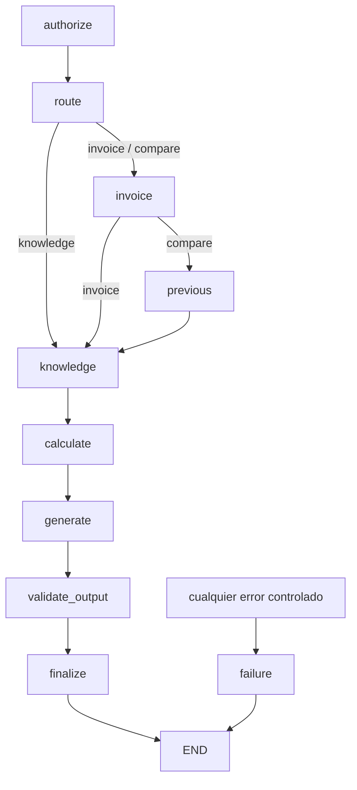

# ADR-011 — Runtime local con LangGraph y evidencia de facturación

- Estado: aceptada para Sprint 3.
- Fecha: 2026-10-15.
- Alcance: ejecución local de snapshots autorizados; sin publicación ni Sprint 4.
- Complementa [ADR-010](ADR-010-agent-management.md) y la arquitectura propuesta.

## Contexto

Sprint 2 conserva configuraciones declarativas, definiciones de catálogo y
snapshots inmutables. Todavía no existe el circuito de evaluación, aprobación
y publicación. Sprint 3 necesita ejecutar una versión concreta con herramientas
reales de lectura, manteniendo la identidad fuera del prompt y los cálculos
monetarios fuera del LLM.

## Decisión

### Ejecución local explícita

Se añade `workflow: {id: billing_workflow_v1, version: 1.0.0}` opcional al contrato
existente. Omitirlo conserva la serialización y los hashes de configuraciones
anteriores. Solo el workflow compilado conocido puede ejecutarse; no se carga
código ni se aceptan nodos o destinos desde JSON.

La ejecución requiere un snapshot y un grant de `agent_invocations` para la
combinación exacta agente/versión/caller. Estos grants se provisionan mediante
el seed local confiable y no se pueden editar por API o manifiesto. Ser
propietario o administrador no concede una invocación. Los agentes permanecen
`draft`; **snapshot y preview no equivalen a PUBLISHED**. El runtime exige
`ENABLE_LOCAL_RUNTIME` y development/test; la configuración rechaza su activación
en producción. Esto amplía la decisión de ADR-010 de posponer ejecución, sin
crear un atajo hacia publicación. Una versión derivada necesita su propio grant.

### StateGraph real y límites

`runtime/graph.py` compila un `langgraph.graph.StateGraph` con `BillingState`
tipado. `Runtime[ExecutionContext]` transporta identidad, sesión, configuración
fijada y presupuestos confiables fuera del estado serializable del grafo.

El enrutamiento inicial usa tareas estructuradas y reglas básicas. El mensaje
puede indicar una referencia de factura, nunca una identidad. El número de
pasos, llamadas (incluidos reintentos), recursión y duración total están
acotados. El seed fija 12 pasos, 5 llamadas y 30 s; cada herramienta tiene
1 s y un reintento. Se combinan timeout async y `SET LOCAL statement_timeout`
para consultas síncronas PostgreSQL. Un fallo terminal conserva run y traza;
no se devuelve evidencia parcial como una respuesta satisfactoria.

La API ejecuta el grafo de forma síncrona y registra cada etapa en PostgreSQL.
No se añaden workers, Redis ni checkpoints: no hay pausas humanas ni un requisito
de reanudación. Una caída abrupta del proceso puede dejar un run `running`;
la reconciliación y recuperación quedan pendientes.

### Executor autorizado y adaptadores registrados

Antes de cada intento se revalidan caller activo, grant, estado del agente,
hash del snapshot, modelo aprobado, definición exacta y permisos del contrato.
Los permisos efectivos son la intersección entre el caller y la política
congelada; un administrador tampoco obtiene un bypass. La consulta de factura
incluye simultáneamente ID y propietario autenticado. Factura ajena e inexistente
tienen el mismo error. El período previo se resuelve con el mes calendario.

Los adaptadores se asignan por ID, nombre, versión y esquemas exactos. Solo
existen tres implementaciones de lectura; no hay SQL/HTTP arbitrario ni importación
de funciones desde un catálogo. Pydantic y JSON Schema validan entrada y salida.
Los contratos anteriores de Sprint 2 no se modifican: el nuevo lookup usa
`get_customer_invoice:3.0.0` (`invoice-lookup-v3`) para devolver evidencia completa.
Los otros adaptadores son `get_previous_invoice:1.0.0` y
`search_billing_knowledge:1.0.0`.

La evidencia de tarifas/FAQ reside en una tabla pequeña versionada, aprobada y
con vigencia. La lectura requiere `invoices:read`, igual que el caso sintético
completo; estos documentos son compartidos entre los dos clientes de demo.
No es un Knowledge Registry completo ni RAG. Las versiones usadas quedan en
las referencias del run y sus tool calls. Antes de liberar la respuesta se
revalidan permisos, propiedad y contenido/aprobación de fuentes.

### Cálculos y Model Gateway

Todos los cargos, diferencias, porcentajes y efectos de consumo/tarifa se
calculan con `Decimal` y `ROUND_HALF_UP`. Se explicita un ajuste de redondeo
para reconciliar la descomposición cuando existen fracciones. Un cargo previo
cero produce porcentaje nulo, sin división por cero. Las facturas solo incluyen
consumo; no representan un sistema tributario o tarifario comercial completo.

El modo `deterministic` utiliza un modelo sintético aprobado y una plantilla
etiquetada. No importa ni invoca LiteLLM; uso y coste permanecen nulos.

El modo `provider` utiliza LiteLLM, exclusivamente con proveedor compatible,
modelo exacto del snapshot, credencial del servidor, timeout y cero reintentos.
Requiere un flag adicional; no hay fallback implícito. Solo se persiste uso
reportado por el SDK y una estimación con precios congelados si ambos conteos
están disponibles. No se calcula uso contando caracteres ni se inventan costes.

El servidor construye afirmaciones verificadas y referencias; el LLM puede
ordenarlas pero debe devolverlas completas y literalmente. Un contrato JSON
cerrado rechaza hechos adicionales, números cambiados, citas ajenas o tool calls.
Las instrucciones del agente y documentos son datos no confiables. Este diseño
limita la redacción libre a cambio de una validación determinista de evidencia.
No se afirma haber validado calidad o compatibilidad con un proveedor real:
los tests sustituyen únicamente el límite del SDK.

### Persistencia y exposición

Cada run referencia versión, hash, modelo y workflow exactos. La migración
`0003_agent_runtime` añade seis tablas con FKs, checks y triggers: solo se
conceden grants a snapshots, la identidad del run no cambia, los runs terminales
son inmutables y los logs son append-only. No se borra historial silenciosamente.

Las APIs permiten consultar únicamente runs y trazas del caller, incluso para
administradores. El Playground utiliza esas APIs por el proxy existente y
muestra estados, evidencia y tiempos medidos. No exporta trazas externamente.
Se guardan argumentos mínimos validados y referencias, sin secretos, prompt
completo ni salidas crudas de herramientas. Los errores no muestran excepciones
del proveedor. El coste mostrado sigue siendo una estimación de catálogo.

## Alternativas y consecuencias

- Ejecutar borradores editables simplificaría el Playground, pero impediría
  identificar la configuración efectiva. Se exige congelar y conceder invocación.
- Añadir publicación y evaluaciones resolvería el ciclo completo, pero excede
  Sprint 3. El preview local queda separado y bloqueado en producción.
- Un LLM que seleccionara herramientas o redactara hechos libremente aumentaría
  flexibilidad y superficie de validación. El primer workflow usa rutas explícitas
  y afirmaciones cerradas; los tests de inyección verifican fronteras concretas,
  sin prometer protección universal contra cualquier ataque.
- No se añade un servicio por agente ni infraestructura de colas. El monolito
  modular mantiene los límites entre Registry, billing y runtime.

Sprint 4 podrá incorporar evaluación, aprobación y publicación con sus propias
políticas. Esas capacidades no se implementan ni se presentan como completas aquí.
